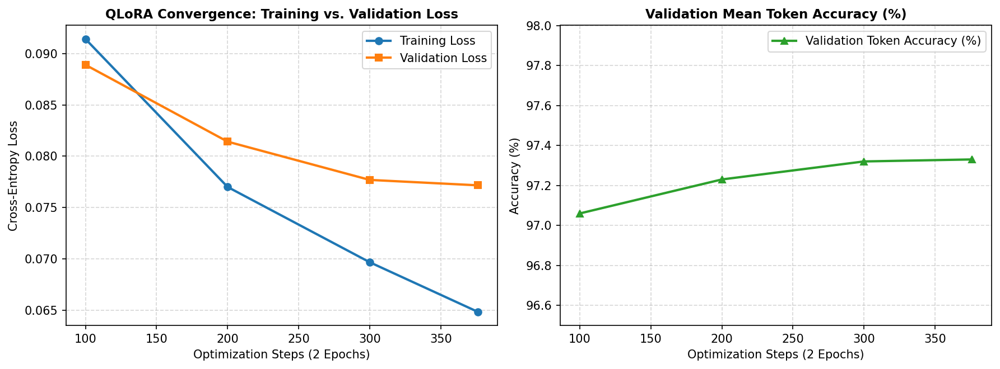

# Agentic Tool-Calling SLM Router (`QLoRA` + `PEFT` + `Pydantic`)

Supervised Fine-Tuning (**QLoRA 4-bit**) of a compact **3B-parameter Small Language Model** (`Qwen/Qwen2.5-3B-Instruct`) specialized in deterministic **Function Calling / Tool Routing** for production agentic workflows.

## Key Benchmark Results (150 Stratified Eval Samples)

| Model Variant | JSON Syntax Validity | Pydantic Schema Compliance | Tool Selection Accuracy |
| :--- | :---: | :---: | :---: |
| `Qwen2.5-3B-Instruct` (Zero-Shot Base) | 2.0% | 0.0% | 0.0% |
| `Qwen2.5-3B-Instruct` + QLoRA (`r=16, alpha=32`) | **100.0%** | **100.0%** | **100.0%** |

- **Trainable Parameters:** `29,933,568` (`0.96%` of `3.12B` total parameters) trained on NVIDIA L4 (`bfloat16`).
- **Convergence:** Validation loss decreased monotonically from `0.0889` (Step 100) to `0.0772` (Step 376) with `97.33%` mean token accuracy and zero overfitting.

## Architecture Overview
- **Dataset Engineering (`data/prepare_dataset.py`):** Curated stratified split (`3,000` train / `400` eval) combining `glaiveai/glaive-function-calling-v2` with synthetic domain edge cases (parallel tool invocation, missing parameter clarification, and out-of-scope refusals).
- **Parameter-Efficient Fine-Tuning (`notebooks/train_qlora_colab.py`):** 4-bit NF4 quantization (`bitsandbytes`) with LoRA adapters (`r=16`, `lora_alpha=32`) targeting all attention and MLP projections via `TRL` `SFTTrainer`.
- **Deterministic Evaluation (`src/evaluate.py`):** Automated benchmark comparing Zero-Shot Base vs. Fine-Tuned adapters using strict **Pydantic v2** (`AgentDecision`) schema validation.
- **Inference Microservice (`src/api_server.py`):** FastAPI endpoint exposing the trained tool router for downstream agent orchestrators.

## Quickstart
- Install dependencies: `pip install -r requirements.txt`
- Build dataset: `python data/prepare_dataset.py`
- Run benchmark: `python src/evaluate.py`
- Start API server: `uvicorn src.api_server:app --host 0.0.0.0 --port 8000`
